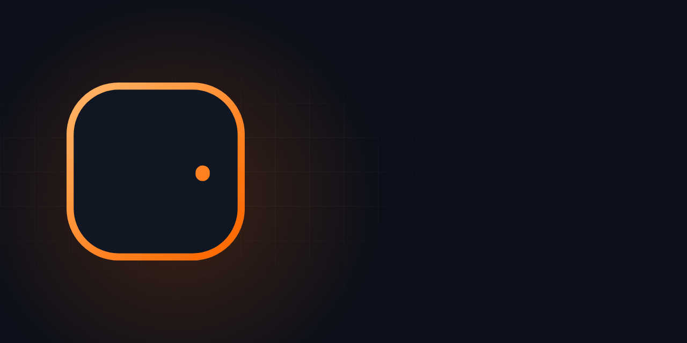
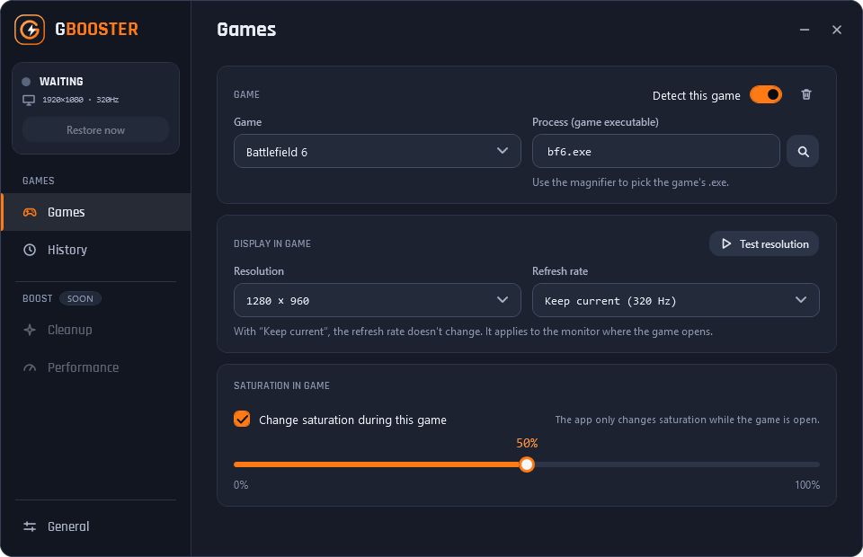

# GBooster

**🇧🇷 Português** · [🇺🇸 English](#english)

> Troca a resolução e a saturação por jogo e otimiza o Windows para jogar. Projeto pessoal, gratuito e de código aberto (licença MIT). Versão **1.0**, em português e inglês, tema escuro. Se encontrar algum problema, abra uma issue.

## O que é

O GBooster é um programa para **Windows 10/11 (64 bits)** que fica na bandeja do sistema e prepara o PC para jogar: troca a resolução e a saturação do monitor quando o jogo abre, aplica ajustes do Windows pensados para jogos e limpa arquivos temporários. Os ajustes e a limpeza só rodam quando você clica, com ponto de restauração e Desfazer. Ele faz três coisas, cada uma na sua página:

1. **Jogos:** quando um jogo cadastrado abre, troca a **resolução** do monitor em que o jogo está
   (por exemplo, uma resolução "esticada" como 1280×960), e opcionalmente a **taxa de atualização (Hz)** e a
   **saturação** (placas NVIDIA). Quando o jogo fecha, **devolve tudo como estava**.
2. **Desempenho e Limpeza (Boost):** aplica ajustes do Windows pensados para jogos e apaga temporários e caches.
   Só roda quando **você clica**, com ponto de restauração e **Desfazer**.
3. **Meu sistema:** mostra informações do PC (processador, memória, placa de vídeo, discos) e mede o timing do Windows.
   Só leitura.

Já vem com **Counter-Strike 2**, **Delta Force** e **Battlefield 6**, e dá para ajustar cada jogo separadamente.

## Para quem é

- Para quem joga competitivo com resolução diferente da nativa e cansou de trocar nas configurações do Windows
  toda vez que abre e fecha o jogo.
- Para quem quer o PC mais leve para jogar, com ajustes que dá para ver, escolher e desfazer.

## O que ele faz

**Jogos (troca de tela)**
- Detecta o jogo pelo nome do programa (`cs2.exe`, `bf6.exe`...) e aplica a configuração desse jogo.
- Resolução, Hz e saturação **por jogo**; a saturação só muda durante o jogo.
- Volta ao normal ao fechar o jogo, ao clicar em **Restaurar resolução agora** (na janela ou na bandeja) ou ao fechar o app.
- Se você restaurar com o jogo ainda aberto, o app **pausa a troca de tela nesse jogo até ele fechar** (status **PAUSADO**), para não ficar trocando de novo em loop. Ao abrir o jogo outra vez, volta ao normal.
- Se o app ou o PC fecharem sem aviso, **na próxima abertura ele desfaz** o que ficou aplicado.
- Botão **Testar resolução** (volta sozinho em alguns segundos) e pausa geral da detecção pela bandeja.

**Desempenho (precisa de administrador, só com clique seu)**
- **Otimizar** aplica 12 ajustes do Windows de uma vez: gravação de tela desligada, plano de energia próprio, sem hibernação, timing do Windows mais preciso (0,5 ms), prioridade para jogos, disco NTFS mais leve, memória sem atrasos, Windows mais ágil ao fechar, telemetria desligada, apps inúteis removidos, perfil NVIDIA para os seus jogos e USB/mouse/teclado. Você escolhe quais aplicar em **O que otimizar**.
- **Ponto de restauração** criado pelo app antes de otimizar, e **Desfazer otimizações** devolve os valores de antes. Os apps do Windows removidos **não** voltam pelo Desfazer (use a Microsoft Store).
- **Pausar atualizações do Windows** é uma chave separada, que você liga e desliga quando quiser.
- Avisa quando o Windows desfaz algum ajuste (por exemplo, depois de uma atualização grande) e oferece **Aplicar de novo**.
- Nada roda sozinho, e **nada é aplicado ou desfeito com um jogo cadastrado aberto**: o app avisa e espera o jogo fechar.

**Limpeza**
- **Analisa** primeiro e mostra o tamanho de cada item (temporários, cache de atualizações, lixeira, cache de shaders, navegadores, Discord, Steam, pontos de restauração antigos etc.). Só apaga o que **você marcar**. Também não roda com jogo aberto.

**Meu sistema**
- Mostra processador, memória (e se o XMP/EXPO parece desligado), placa de vídeo, discos e Windows, e **mede o timing do Windows** (perto de 1 ms é ótimo; 15,6 ms é o padrão). Pode copiar o resumo ou abrir no Bloco de Notas.

**No dia a dia**
- Menu lateral com **Jogos, Desempenho, Limpeza, Geral, Histórico e Meu sistema**, botão **?** (Ajuda), tour de boas-vindas (dá para repetir) e janela **Dicas antes de usar**.
- Histórico de eventos, avisos, início com o Windows, backup das configurações (exportar/importar) e app em **português e inglês** (Geral → Sistema → Idioma).
- **F12** (ou o botão de print na barra de cima) tira um print da janela do GBooster, salva em `Imagens\GBooster` e copia para a área de transferência.

## Como fica

    
    
    
  

(As imagens mostram o app em inglês; no app dá para trocar para português em Geral → Sistema → Idioma.)

## O que ele garante (e o que não garante)

**Garante:**
- **Não toca no jogo.** Não abre o processo do jogo, não lê nem escreve na memória, não injeta DLL, não usa hooks, drivers nem overlay. O print (F12) captura só a janela do próprio GBooster.
- **Só usa recursos públicos do Windows e da NVIDIA** (a mesma API do programa QRes para a resolução; a API pública NvAPI para a saturação e para o perfil NVIDIA; ferramentas do próprio Windows, como `powercfg`, `bcdedit` e `fsutil`, nos ajustes).
- **Sem internet, sem conta, sem telemetria.** Nada sai do seu computador. Os dados ficam em `%AppData%\GBooster`.
- **Código aberto**: qualquer pessoa pode conferir tudo o que ele faz.
- **Tudo reversível** (exceto os apps removidos pelo Otimizar): cada ajuste guarda o valor de antes, e o app só desfaz o que ele mesmo aplicou.
- **Não mexe em proteções do Windows** (Windows Defender, VBS/HVCI, Secure Boot, Spectre, ASLR etc.) nem instala driver.

**Não garante:**
- **Não existe garantia de "100% sem banimento".** Nenhuma desenvolvedora de jogo publica uma lista de programas permitidos. A troca de tela não faz nada do que as regras públicas proíbem, mas a decisão final é sempre do anti-cheat. A **saturação** é a parte mais sensível (pode ser vista como "vantagem visual"); leia o [relatório](RELATORIO-ANTICHEAT.md) e use por sua conta e risco. Com saturação em 50% (padrão), o app nem mexe no driver.
- **Anti-cheats que checam o estado do sistema** (como o Riot Vanguard, do Valorant) podem se incomodar com ajustes de boot e de driver. O GBooster **não foi testado com o Valorant**; se você joga, não cadastre esse jogo e veja o relatório.
- Sem garantias de qualquer tipo (ver licença MIT).

## Como instalar

1. Em **Releases**, baixe `GBooster-win-x64.zip`.
2. Extraia numa pasta (por exemplo, `C:\GBooster`).
3. Dê dois cliques em `GBooster.exe`. **Não precisa instalar o .NET.**

> **Aviso do Windows (SmartScreen):** como o programa não tem assinatura digital paga, o Windows pode mostrar
> "O Windows protegeu o computador". Clique em **Mais informações → Executar assim mesmo**.
> Você pode conferir o arquivo com o `SHA256.txt` da versão.

**Verificação de segurança (v1.0):** o `GBooster-win-x64.zip` da versão 1.0 foi analisado no VirusTotal: **0 de 64 antivírus** marcaram como malicioso ([ver relatório](https://www.virustotal.com/gui/file/1128b2e1e75166827cbb8bcf2f8cb16e598ae05ec1787c8de07fd3d419348d21)). Isso ajuda, mas não é garantia: alguns antivírus não conseguem analisar arquivos `.zip` e programas novos podem ser marcados por engano. O código é aberto para você conferir.

A troca de tela funciona **sem administrador**. Para Desempenho, Limpeza (alguns itens) e ponto de restauração, use o botão **Reiniciar como administrador** que aparece no app.

## Primeiro teste (nesta ordem)

1. Abra o app, página **Jogos**, escolha o jogo e a resolução (a mesma do jogo).
2. Deixe a saturação desligada e clique em **Testar resolução**. A tela troca e volta sozinha.
3. Confira que **Restaurar resolução agora** devolve a tela.
4. Só depois teste com o jogo aberto e, por último, a saturação.
5. Para o Boost: **crie o ponto de restauração** na página Desempenho, feche programas como ISLC, Wub, Timer Resolution e MSI util, e só então clique em **Otimizar**. Reinicie o PC quando o app pedir.

Se algo travar a tela: use **Restaurar resolução agora**, na janela ou no menu da bandeja.

## Configuração da placa de vídeo (o app não faz por você)

Para a resolução esticada ocupar a tela toda, no Painel de Controle NVIDIA: *Ajustar o tamanho e a posição da
área de trabalho* → Escala: **Tela inteira**, executar em **GPU**, e marque *Substituir o modo de escala definido
por jogos e programas*. A tela de ajuda dentro do app tem o passo a passo.

## Limitações conhecidas

- A saturação e o perfil NVIDIA funcionam **somente com placas NVIDIA**. Resolução, Hz e o resto do Boost funcionam em qualquer placa.
- Os nomes dos programas dos jogos podem mudar com atualizações; dá para corrigir no app (lupa).
- Com vários monitores, o app muda o monitor em que o jogo abrir.
- Em notebook, o Boost gasta mais bateria e esquenta mais (tela sempre ligada, PCIe sem economia, timing de 0,5 ms).
- Ferramentas como ISLC, Wub, Timer Resolution, MSI util e o "otimizar jogos" da NVIDIA podem disputar os mesmos ajustes. Atualizações grandes do Windows podem desfazer parte deles.
- O modo MSI, em poucos PCs, causa chiado no áudio ou travadas (dá para desfazer, mas pede reinício).
- Testado até agora só em um PC com placa NVIDIA; o resto ainda precisa de mais testes.

## Tecnologia e transparência

| Ação | Como | Toca o jogo? |
|---|---|---|
| Saber se o jogo abriu | Lista de processos do Windows, a cada 2 s | Não |
| Achar o monitor do jogo | Posição da janela | Não |
| Trocar resolução/Hz | `ChangeDisplaySettingsEx` (temporário, sem gravar no registro) | Não |
| Saturação e perfil NVIDIA | NvAPI ("Vibrância digital" e perfis do driver) | Não |
| Ajustes do Desempenho | Registro do Windows, `powercfg`, `bcdedit`, `fsutil`, serviços, só ao clicar em Otimizar, com backup de cada valor | Não |
| Limpeza | Apaga só pastas conhecidas de temporários e caches, só o que você marcar | Não |
| Medir o timing | Mede quanto o Windows leva para acordar o próprio GBooster por 3 s | Não |

Arquivos do app em `%AppData%\GBooster\`: `settings.json`, `applied.json` (some ao restaurar), `log.json`, `actions.json` e `tweaks.json` (valores de antes dos ajustes, para o Desfazer), `nvidia.json` e `timer-medidas.json`.
"Iniciar com o Windows" cria uma entrada em `HKCU\...\Run`; desmarcar remove.

## Compilar você mesmo

Instale o **.NET 8 SDK** e dê dois cliques em `COMPILAR.bat` (ou rode
`dotnet publish -c Release -r win-x64 --self-contained true -o publicar`). O programa fica em `publicar\GBooster.exe`.

## Segurança, licença e agradecimentos

- Achou um problema de segurança? Veja [SECURITY.md](SECURITY.md).
- Código sob licença **MIT** (arquivo `LICENSE`), © 2026 [Matheus Gheno](https://github.com/matheusgheno).
- Usa **NvAPIWrapper.Net** (LGPL-3.0), sem modificações, e os identificadores de opções do **NVIDIA Profile Inspector** (MIT). Veja [THIRD-PARTY-NOTICES.md](THIRD-PARTY-NOTICES.md).
- Não tem relação com NVIDIA, Valve, Tencent/Level Infinite/Garena, EA ou Riot Games. Marcas pertencem aos seus donos.

---

# GBooster (English)

> Per-game resolution and saturation switching, plus Windows tweaks for gaming. A free, open-source personal project (MIT license). Version **1.0**, in Portuguese and English, dark theme. If you find a problem, please open an issue.

## What it is

GBooster is a **Windows 10/11 (64-bit)** tray app that gets your PC ready for gaming: it switches the monitor's resolution and saturation when a game starts, applies Windows tweaks aimed at gaming and cleans temporary files. The tweaks and the cleanup only run when you click, with a restore point and Undo. It does three things, each on its own page:

1. **Games:** when a configured game starts, it switches the **resolution** of the monitor the game is on
   (for example a stretched resolution like 1280×960), and optionally the **refresh rate (Hz)** and the
   **color saturation** (NVIDIA GPUs). When the game closes, it **puts everything back exactly as it was**.
2. **Performance and Cleanup (Boost):** applies Windows tweaks aimed at gaming and deletes temp files and caches.
   It only runs when **you click**, with a restore point and **Undo**.
3. **My system:** shows PC information (processor, memory, graphics card, disks) and measures Windows timing.
   Read-only.

It comes preconfigured for **Counter-Strike 2**, **Delta Force** and **Battlefield 6**, and each game can be tuned separately.

## Who it's for

- Competitive players who use a non-native resolution and are tired of changing it in Windows settings every time
  they start and quit a game.
- Anyone who wants a lighter PC for gaming, with tweaks you can see, choose and undo.

## What it does

**Games (screen switching)**
- Detects the game by its executable name (`cs2.exe`, `bf6.exe`...) and applies that game's settings.
- Resolution, Hz and saturation **per game**; saturation only changes while the game is running.
- Reverts when the game closes, when you click **Restore resolution now** (in the window or the tray), or when you quit the app.
- If you restore while the game is still open, the app **stops switching the screen for that game until it closes** (status **PAUSED**), so it doesn't loop. When you open the game again, it works as usual.
- If the app or the PC shuts down unexpectedly, **it undoes what was left applied** the next time it starts.
- **Test resolution** button (reverts by itself after a few seconds) and a tray option to pause all detection.

**Performance (needs administrator, only when you click)**
- **Optimize** applies 12 Windows tweaks at once: screen recording off, a dedicated power plan, no hibernation, more precise Windows timing (0.5 ms), game priority, lighter NTFS disk, memory without delays, snappier Windows when closing, telemetry off, useless apps removed, NVIDIA profile for your games, and USB/mouse/keyboard. You choose which ones to apply under **What to optimize**.
- A **restore point** created by the app before optimizing, and **Undo optimizations** restores the previous values. Removed Windows apps do **not** come back with Undo (use the Microsoft Store).
- **Pause Windows updates** is a separate switch you can turn on and off any time.
- It warns you when Windows undoes a tweak (for example after a big update) and offers **Apply again**.
- Nothing runs by itself, and **nothing is applied or undone while a configured game is open**: the app tells you and waits for the game to close.

**Cleanup**
- **Analyzes** first and shows the size of each item (temp files, update cache, Recycle Bin, shader cache, browsers, Discord, Steam, old restore points, etc.). It only deletes what **you tick**. It doesn't run while a game is open either.

**My system**
- Shows processor, memory (and whether XMP/EXPO looks off), graphics card, disks and Windows, and **measures Windows timing** (close to 1 ms is great; 15.6 ms is the default). You can copy the summary or open it in Notepad.

**Day to day**
- Side menu with **Games, Performance, Cleanup, General, History and My system**, a **?** Help button, a welcome tour (repeatable) and a **Tips before you start** window.
- Event history, notifications, start with Windows, settings backup (export/import) and the app in **Portuguese and English** (General → System → Language).
- **F12** (or the screenshot button in the top bar) takes a screenshot of the GBooster window, saves it to `Pictures\GBooster` and copies it to the clipboard.

## Screenshots

    
    
    
  

## What it guarantees (and what it doesn't)

**It guarantees:**
- **It never touches the game.** It doesn't open the game process, read or write its memory, inject DLLs, hook anything, install drivers or draw overlays. The screenshot (F12) only captures GBooster's own window.
- **It only uses public Windows and NVIDIA features** (the same API as the QRes tool for resolution; NVIDIA's public NvAPI for saturation and the NVIDIA profile; Windows' own tools such as `powercfg`, `bcdedit` and `fsutil` for the tweaks).
- **No internet, no account, no telemetry.** Nothing leaves your computer. Data stays in `%AppData%\GBooster`.
- **Open source**: anyone can check everything it does.
- **Reversible** (except the Windows apps removed by Optimize): each tweak saves its previous value, and the app only undoes what it applied itself.
- **It doesn't touch Windows protections** (Windows Defender, VBS/HVCI, Secure Boot, Spectre, ASLR, etc.) and doesn't install drivers.

**It does not guarantee:**
- **There is no "100% ban-proof" guarantee.** No game publisher releases a list of allowed programs. Screen switching does
  nothing that the published rules forbid, but the final call always belongs to the anti-cheat. **Saturation** is the
  most sensitive part (it could be seen as a "visual advantage"); read the [report](RELATORIO-ANTICHEAT.md) (Portuguese) and use it at your own risk.
  At 50% saturation (default) the app doesn't touch the driver at all.
- **Anti-cheats that check system state** (such as Riot Vanguard, used by Valorant) may react to boot and driver tweaks. GBooster **has not been tested with Valorant**; if you play it, don't add that game and see the report.
- No warranty of any kind (see the MIT license).

## Installation

1. Under **Releases**, download `GBooster-win-x64.zip`.
2. Extract it to a folder (for example `C:\GBooster`).
3. Double-click `GBooster.exe`. **No .NET installation needed.**

> **Windows SmartScreen warning:** since the app has no paid code-signing certificate, Windows may show
> "Windows protected your PC". Click **More info → Run anyway**.
> You can verify the download with the release's `SHA256.txt`.

**Security check (v1.0):** the v1.0 `GBooster-win-x64.zip` was scanned on VirusTotal: **0 of 64 antivirus engines** flagged it as malicious ([see report](https://www.virustotal.com/gui/file/1128b2e1e75166827cbb8bcf2f8cb16e598ae05ec1787c8de07fd3d419348d21)). This helps but is not a guarantee: some engines can't scan `.zip` files, and new programs can be flagged by mistake. The code is open for you to check.

Screen switching works **without administrator**. For Performance, some Cleanup items and the restore point, use the **Restart as administrator** button shown in the app.

## First run (in this order)

1. Open the app, **Games** page, pick the game and the resolution (the same one the game uses).
2. Keep saturation off and click **Test resolution**. The screen switches and comes back by itself.
3. Check that **Restore resolution now** brings the screen back.
4. Only then try it with the game running, and saturation last.
5. For Boost: **create the restore point** on the Performance page, close tools such as ISLC, Wub, Timer Resolution and MSI util, and only then click **Optimize**. Restart the PC when the app asks.

If anything locks your screen: use **Restore resolution now**, in the window or the tray menu.

> Choose the interface language under General → System → Language (Portuguese or English).

## GPU setup (the app doesn't do this for you)

For a stretched resolution to fill the screen, in the NVIDIA Control Panel: *Adjust desktop size and position* →
Scaling: **Full-screen**, perform scaling on **GPU**, and tick *Override the scaling mode set by games and programs*.
The Help page inside the app has the step-by-step.

## Known limitations

- Saturation and the NVIDIA profile work on **NVIDIA GPUs only**. Resolution, Hz and the rest of Boost work on any GPU.
- Game executable names can change with game updates; you can fix them in the app (magnifier button).
- With multiple monitors, the app changes the monitor the game opens on.
- On laptops, Boost uses more battery and runs hotter (screen always on, no PCIe power saving, 0.5 ms timing).
- Tools such as ISLC, Wub, Timer Resolution, MSI util and NVIDIA's "optimize games" can fight over the same settings. Big Windows updates can undo part of them.
- MSI mode, on a few PCs, causes audio crackle or stutters (it can be undone, but needs a restart).
- Tested so far only on one PC with an NVIDIA card; the rest still needs more testing.

## Technology and transparency

| Action | How | Touches the game? |
|---|---|---|
| Know whether the game started | Windows process list, every 2 s | No |
| Find the game's monitor | Window position | No |
| Change resolution/Hz | `ChangeDisplaySettingsEx` (temporary, not saved to the registry) | No |
| Saturation and NVIDIA profile | NvAPI ("Digital Vibrance" and driver profiles) | No |
| Performance tweaks | Windows registry, `powercfg`, `bcdedit`, `fsutil`, services; only when you click Optimize, with each value backed up | No |
| Cleanup | Deletes only known temp and cache folders, only what you tick | No |
| Measure timing | Measures how long Windows takes to wake GBooster itself for 3 s | No |

App files in `%AppData%\GBooster\`: `settings.json`, `applied.json` (removed on restore), `log.json`, `actions.json` and `tweaks.json` (previous values of the tweaks, for Undo), `nvidia.json` and `timer-medidas.json`.
"Start with Windows" creates an entry under `HKCU\...\Run`; unticking it removes it.

## Build it yourself

Install the **.NET 8 SDK** and double-click `COMPILAR.bat` (or run
`dotnet publish -c Release -r win-x64 --self-contained true -o publicar`). The app ends up in `publicar\GBooster.exe`.

## Security, license, credits

- Found a security issue? See [SECURITY.md](SECURITY.md).
- Code under the **MIT** license (`LICENSE`), © 2026 [Matheus Gheno](https://github.com/matheusgheno).
- Uses **NvAPIWrapper.Net** (LGPL-3.0), unmodified, and the option identifiers from **NVIDIA Profile Inspector** (MIT). See [THIRD-PARTY-NOTICES.md](THIRD-PARTY-NOTICES.md).
- Not affiliated with NVIDIA, Valve, Tencent/Level Infinite/Garena, EA or Riot Games. Trademarks belong to their owners.
